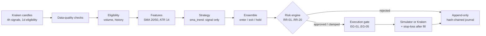

# crypto-trader

[](https://github.com/daharimp/crypto-trader/actions/workflows/ci.yml)


A risk-first crypto trading bot. It trades **spot** BTC, ETH, SOL, XRP, and SUI on
**Kraken**. **Paper trading is the default.** Real-money trading is available only behind
owner-approved gates.

> [!WARNING]
> **You can lose real money.** Results are not forecasts, and profitability is not
> guaranteed or implied. The only strategy so far (`sma_trend`) has been tested on synthetic
> data and a short paper period. This is not financial advice.

## Contents

- [How it works](#how-it-works)
- [Safety controls](#safety-controls)
- [Quick start (local)](#quick-start-local)
- [Going live on Kraken](#going-live-on-kraken)
- [Commands](#commands)
- [Configuration](#configuration)
- [Project layout](#project-layout)
- [Development](#development)
- [Project status](#project-status)
- [Documentation map](#documentation-map)

## How it works

Every 4 hours, at each candle close (00, 04, 08, 12, 16, 20 UTC), the bot runs one decision
cycle. The same pipeline runs in backtests, paper trading, and live trading:



- **Strategies:** `sma_trend` (default), plus research baselines `tsmom`, `mean_reversion`,
  `volatility_breakout`, and a `random_entry` control that sessions refuse.
- **Strategies never size orders.** They emit a direction only. A deterministic risk engine
  approves, shrinks, or rejects every proposal and computes the size.
- **Sizing:** 1% of equity at risk per trade, with a stop at 2 × ATR(14) below entry. It is
  then capped by per-asset and total exposure limits and the cash reserve, and reduced as
  drawdown grows.
- **Every order is traceable.** Each one links back to its signal, strategy version, risk
  decision, configuration hash, and market data (`trader journal verify`).

### Universe

| Tier | Assets | Per-asset cap | Eligibility (Kraken, checked every cycle) |
|---|---|---|---|
| Core | BTC, ETH | 35% | ≥ $50M median daily volume, ≥ 365 days of history |
| Major | SOL, XRP | 15% | ≥ $10M, ≥ 365 days |
| Speculative | SUI | 5% (10% total) | ≥ $1M, ≥ 180 days |

An asset that fails eligibility is simply not traded that cycle.

## Safety controls

| Control | What it does |
|---|---|
| Paper by default | `live` requires an owner-signed authorization, a capital cap, a completed paper track record, and an activation record tied to the exact profile content ([ADR-023](docs/decisions/ADR-023-gated-live-trading.md)) |
| Capital cap | The bot manages at most `max_capital_usd` (currently **$250**), even if the account holds more |
| Spot only | No leverage, margin, short selling, withdrawal, or transfer code; the adapter can send only allowlisted order parameters; safety tests scan for violations |
| Protective stops | After every buy, a stop-loss order rests **at Kraken**, so positions stay protected even if the server is down |
| Loss limits | Daily loss limit 3% (lockout until 00:00 UTC); drawdown circuit breaker 15% (latched until the owner resets it); smaller sizes as drawdown grows; cooldown after 3 losses |
| Kill switch | `trader killswitch engage` blocks all new orders. It also engages **automatically** on balance mismatch with Kraken, a missing stop, clock skew > 5 s, 3 stale-data cycles, 3 exchange errors, a mid-session config change, or any unexpected error |
| Owner flatten | `trader session flatten` sells everything through the risk engine, even with the kill switch on |
| Fail closed | Any unresolved owner decision (`TBD`) stops the run (exit 3); nothing is defaulted |
| Secrets | API keys live only in `.env` on the server, never in the repo, configs, or logs |

## Quick start (local)

Requires Python 3.11+ and [uv](https://docs.astral.sh/uv/). No API keys or network access
are needed for the demo.

```bash
git clone https://github.com/daharimp/crypto-trader.git
cd crypto-trader
uv sync
uv run trader version
uv run python scripts/demo_vertical_slice.py     # synthetic data -> backtest -> report
```

The demo validates the profile, creates synthetic datasets for all five assets, runs a
backtest against buy-and-hold benchmarks, prints the report, and verifies the journal.

## Going live on Kraken

Follow **[`docs/operations/RUNBOOK.md`](docs/operations/RUNBOOK.md)** step by step:

1. Set up a small Linux server with Docker.
2. Start **paper trading** on live Kraken prices (`docker compose up -d paper`).
3. Create a Kraken API key **without withdrawal permission** for a separate, USD-only
   account; put it in `.env` on the server.
4. Run `trader live preflight`. It validates keys and order shapes without placing orders.
5. Write your acknowledgement in `configs/live/authorization.yaml`. Live unlocks after
   **42 completed paper cycles** (about a week).
6. Activate live and start it (`docker compose --profile live up -d live`).

## Commands

| Command | Purpose |
|---|---|
| `trader version` | Version and safety statement |
| `trader profile validate PROFILE -e backtest\|paper\|live` | Show whether a run is allowed, every error, and unresolved decisions (exit 0/2/3) |
| `trader profile build [--answers FILE] [--dry-run] [--update]` | Interview: one question per risk setting with the spec's options; writes your own named profile, risk file, and spec sheet ([web form](docs/profile-builder/index.html)) |
| `trader profile activate PROFILE -e paper\|live --reason "..."` | Owner activation record (required for paper and live) |
| `trader session run --profile PROFILE -e paper\|live [--once]` | Run a forward session |
| `trader session status` | Last cycle, equity, positions, breaker, stale cycles |
| `trader session flatten --reason "..."` | Sell all positions now |
| `trader session reset-breaker --reason "..."` | Reset a tripped drawdown breaker |
| `trader killswitch status\|engage\|disengage --reason "..."` | Persisted kill switch |
| `trader live preflight --profile PROFILE` | Check Kraken keys, permissions, balances, and order shapes; places no orders |
| `trader data synth\|import\|import-kraken\|fetch\|validate\|list` | Immutable, content-addressed datasets (`import-kraken` reads Kraken's downloadable OHLCVT history) |
| `trader research compare --profile ... --datasets ... --start ... --end ...` | Compare strategies across windows and cost scenarios against buy-and-hold and a matched random-entry control |
| `trader backtest run --profile ... --datasets ID,... --strategy sma_trend --timeframe 4h` | Research backtest |
| `trader report show RUN_ID [--format md\|json]` | Backtest report |
| `trader journal verify RUN_ID` | Verify the hash chain and order traceability (exit 4 on tampering) |

Exit codes: `0` success · `1` internal error · `2` invalid input or refused by a gate ·
`3` blocked by an unresolved owner decision · `4` integrity check failed.

On the server, prefix commands with `docker compose run --rm cli`, for example
`docker compose run --rm cli session status`.

## Configuration

All configuration is versioned YAML under `configs/`. Every edit needs a version increment,
and approved values record who approved them and when.

| File | Holds |
|---|---|
| `configs/profiles/balanced-paper.yaml` | Trading profile: capital, universe, timeframes, permitted environments |
| `configs/risk/{conservative,balanced,aggressive}.yaml` | Risk limits, sizing, stops, cooldowns, fault thresholds |
| `configs/universe/assets.yaml`, `eligibility.yaml` | Assets, tiers, Kraken symbols, eligibility thresholds |
| `configs/live/authorization.yaml` | Live capital cap, paper prerequisite, owner acknowledgement |
| `configs/costs/*.yaml` | Fee and slippage scenarios |
| `.env` (server only, never committed) | `KRAKEN_API_KEY`, `KRAKEN_API_SECRET`, optional `ALERT_WEBHOOK_URL` ([`.env.example`](.env.example)) |

Environment variables: `TRADER_DATA_DIR` (default `./data`) and `TRADER_CONFIGS_DIR`
(default `./configs`).

## Project layout

```text
src/trader/
  domain/       framework-neutral Pydantic contracts (stdlib + pydantic only)
  profiles/     compiler, policy rules, experiment overlay, live authorization
  data/         candle providers, quality checks, immutable dataset store, snapshots
  universe/     asset registry, point-in-time eligibility
  features/  regimes/  strategies/  ensemble/
  risk/         rules RR-01..RR-20, sizing, loss state, breaker, cooldowns, kill switch
  execution/    gate EG-01..EG-05, simulator, Kraken live adapter
  portfolio/    ledger and reconciliation
  pipeline/     the decision cycle shared by backtest, paper, and live
  session/      forward sessions, Kraken data, state, flatten, alerts, preflight
  journal/  evaluation/  backtest/  research/  cli/
configs/  schemas/  experiments/  scripts/  tests/  docs/
```

## Development

```bash
uv sync
uv run ruff check . && uv run ruff format --check .
uv run mypy src
uv run pytest            # 300+ tests, offline; a fake exchange stands in for Kraken
```

CI runs these on every pull request. See [CONTRIBUTING.md](CONTRIBUTING.md) for the rules,
especially the safety rules in [CLAUDE.md](CLAUDE.md).

## Project status

| Area | Status |
|---|---|
| Backtesting, risk engine, journal (M1) | Done |
| Owner risk decisions UD-01 to UD-22 | Approved (see `docs/spec/product-requirements.md` §10.2) |
| Paper trading on live Kraken prices | Ready; verified against real Kraken data |
| Live trading | Built and gated; waiting on server setup, API key, preflight, the owner acknowledgement, and 42 paper cycles |
| Real-data strategy evaluation | First test done ([EXP-2026-002](docs/experiments/EXP-2026-002-kraken-120d.md)): on 120 days of real data `sma_trend` was beaten by buy-and-hold. **No edge shown yet.** [EXP-2026-003](docs/experiments/EXP-2026-003-strategy-comparison-120d.md) compared four strategies against a random control: none beat holding in rising markets; limit orders cut fees by about a third. The full-history rerun needs Kraken's downloadable data |

Open items: [`BLOCKERS.md`](BLOCKERS.md) and [`TASK.md`](TASK.md). History:
[`CHANGELOG.md`](CHANGELOG.md).

## Documentation map

| Document | What it covers |
|---|---|
| [`docs/operations/RUNBOOK.md`](docs/operations/RUNBOOK.md) | Server setup, paper, preflight, going live, daily operation, emergencies |
| [`docs/spec/`](docs/spec/README.md) | The original specification package (requirements, architecture, risk schema) |
| [`docs/decisions/`](docs/decisions/) | Architecture decision records (ADR-001 to ADR-024) |
| [`PLANNING.md`](PLANNING.md) | Architecture summary and current milestone |
| [`SUPPORT.md`](SUPPORT.md) | Where to get help |
| [`SECURITY.md`](SECURITY.md) | Reporting vulnerabilities; what to do if a key is exposed |
| [`CONTRIBUTING.md`](CONTRIBUTING.md) · [`CODE_OF_CONDUCT.md`](CODE_OF_CONDUCT.md) | How changes are made |

## License

Proprietary. Copyright © 2026 Dahari Morgan-Parker. All rights reserved. See
[LICENSE](LICENSE).
